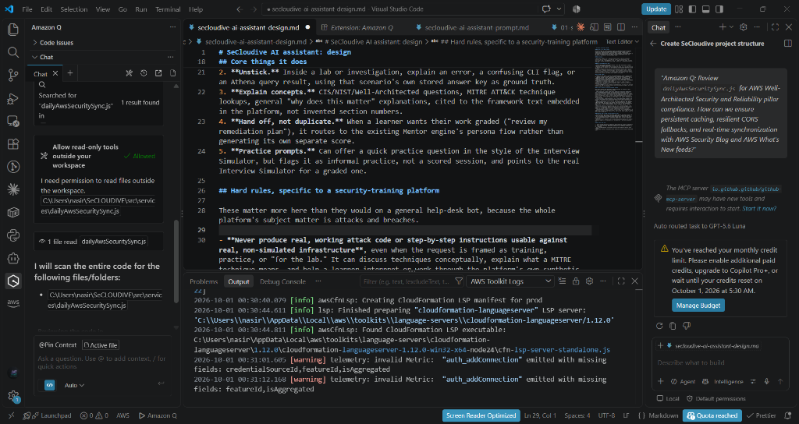

# SeCloudive

SeCloudive is a Cloud Security Career Development Platform that helps learners practice the judgment of a cloud security engineer. Instead of memorizing AWS services, users investigate realistic IAM, S3, networking, monitoring, and architecture incidents, explain business impact, review remediation, and build a career-focused learning plan.

## Features

- **Flagship Security Investigation Simulator:** 25 realistic incident tickets across 5 domains (IAM, S3, Networking, Monitoring, Architecture) with real-world business context and blast radius triage.
- **Forensic Evidence Locker:** Interactive tabbed viewer inspecting raw IAM policies, CloudTrail event telemetry, VPC routing tables, security groups, and KMS configurations with line numbers and analyst notes.
- **5-Phase Incident Investigation Workflow:** Executive Context &rarr; Operational Tasks &rarr; Forensic Evidence &rarr; Findings Identification & Severity Escalation &rarr; Resolution Dossier.
- **Official Incident Resolution Dossier:** Root Cause Analysis (RCA), Technical Security Impact, Business & Compliance Impact, Step-by-Step Remediation Plan, AWS Well-Architected Best Practices, and Lessons Learned.
- **Incident Post-Mortem Exporter:** One-click download of executive markdown post-mortem reports for learner portfolios and technical job interviews.
- **SOC Weekly On-Call Internship Simulator:** Rotational incident triage with attack timeline replay.
- **Multi-Finding AWS Architecture Security Reviews:** 5 signature multi-finding review cards spanning zero trust, serverless, and perimeter defense.
- **Security Thinking Report:** Real-time analysis of strengths, weaknesses, career readiness standing, and domain mastery.
- **Personalized AWS Learning Paths:** Dynamically generated curriculum based on the learner's weakest security domain.
- **Fast Code-Split Architecture:** React 19 lazy-loading with Vite, sub-300ms production builds, and persistent `localStorage` state.

## Architecture

- React 19 with Vite 8
- React Router 7 with code-split route lazy-loading (`React.lazy` & `Suspense`)
- Context-based challenge and investigation progress state (`ChallengeContext`)
- Normalized challenge data under `src/data` (including 25 production incidents in `investigations.js`)
- Reusable components under `src/components` (EvidenceViewer, InvestigationCard, AttackTimeline, CareerRoadmap, etc.)
- 100% static frontend architecture; zero backend dependencies, no external databases or paid API keys required

Primary routes:

- `/` Home (Field lab landing page with direct simulator launch)
- `/investigations` Flagship Security Investigation Simulator Hub
- `/investigations/:id` 5-phase active incident workspace & forensic evidence locker
- `/dashboard` SOC operations dashboard and maturity assessment
- `/categories` Scenario-based challenge library
- `/challenge/:id` Micro-investigation scenario workflow
- `/architecture-reviews` Architecture review studio
- `/internship-simulator` SOC on-call weekly ticket simulator
- `/report` Security Thinking Report and career learning paths
- `/about` Mission and pedagogical approach

## AWS Services Used

- **AWS Amplify:** intended GitHub-connected hosting and continuous deployment
- **Amazon S3:** represented as a learning domain and official documentation resource; the app does not provision or call an application-owned bucket
- **GitHub:** source repository and Amplify integration target

## Run Locally

Requirements: Node.js 18+ and npm.

```bash
npm install
npm run dev
```

Open the local Vite URL shown in the terminal.

## Production Build

```bash
npm run build
npm run preview
```

## Deployment Instructions

See [DEPLOYMENT.md](DEPLOYMENT.md) for GitHub and AWS Amplify setup, build commands, troubleshooting, and verification steps.

The repository includes [amplify.yml](amplify.yml), which installs dependencies with `npm ci`, runs `npm run build`, and publishes `dist`.

## 🤖 Built with Amazon Q Developer

Amazon Q Developer was utilized as an AI-powered cloud security and coding assistant throughout the engineering of SeCloudive. It provided real-time architectural guidance, assisted in drafting incident forensic dossiers, and helped optimize live AWS security telemetry ingestion.

### Key Assistance Highlights:
- **AWS Well-Architected Framework Alignment**: Validated IAM zero-trust, CloudTrail log integrity verification, and S3 Public Access Block patterns across all 25 incident response simulators.
- **Live AWS Security Intelligence Optimization**: Assisted in engineering the multi-stream RSS ingestion and local cache invalidation engine in [`src/services/dailyAwsSecuritySync.js`](src/services/dailyAwsSecuritySync.js).
- **Incident Remediation Runbooks**: Formulated verified AWS CLI mitigation scripts and forensic investigation playbooks used in the Forensic Evidence Locker.

### Verified Amazon Q Developer Prompts:
> **Prompt 1 (Architecture & Reliability Review):**
> *"Amazon Q: Review `dailyAwsSecuritySync.js` for AWS Well-Architected Security and Reliability pillar compliance. How can we ensure persistent caching, resilient CORS fallbacks, and real-time synchronization with AWS Security Blog and AWS What's New feeds?"*

> **Prompt 2 (IAM Least-Privilege & PassRole Forensics):**
> *"Amazon Q: Generate a realistic CloudTrail event log and step-by-step AWS CLI remediation runbook for an IAM privilege escalation incident where an unprivileged developer role uses `iam:PassRole` to execute an administrative Lambda function."*

> **Prompt 3 (Frontend Security Hardening):**
> *"Amazon Q: Review the interactive terminal and evidence viewer components for XSS vulnerabilities, strict sanitized input handling, and secure external documentation linking."*

### Proof of Tool Usage:

*(Captures Amazon Q Developer actively analyzing SeCloudive's codebase in VS Code)*

## Screenshots & Submission Proof

Checklist of proof assets for final hackathon submission:

- [x] **Amazon Q Developer Active in VS Code** (`docs/screenshots/amazon-q-developer-proof.png`)
- [ ] Coding agent & AWS Toolkit active in VS Code
- [ ] Public GitHub repository with clean commit history
- [ ] Successful AWS Amplify build logs
- [ ] AWS Amplify production application dashboard
- [ ] Live public SeCloudive URL
- [ ] 25-ticket Incident Simulator & Forensic Evidence Locker walkthrough
- [ ] Security Thinking Report & AWS Learning Paths

## Hackathon Information

SeCloudive is designed for the AWS Zero to Shipped Startup lane and supports the Social Good category by making practical cloud security career development accessible to students, career switchers, and aspiring cloud security engineers worldwide.

The product's core differentiator is active security thinking: forensic investigation, blast radius triage, risk identification, architecture review, remediation reasoning, and career readiness.

See [docs/HACKATHON_PROOF.md](docs/HACKATHON_PROOF.md) for coding-agent evidence, deployment workflow, Builder Center content, and submission compliance checklists.

## Release Status

The source is 100% GitHub and AWS Amplify compatible. Final public submission requires connecting the repository to GitHub, deploying through Amplify, and attaching the genuine screenshots from the checklist above.

