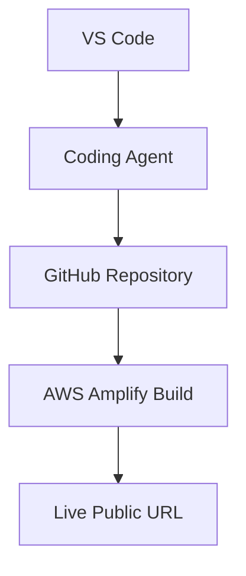

# SeCloudive Hackathon Proof

## Project Overview

SeCloudive is a frontend-only Cloud Security Career Development Platform. It helps learners practice security investigations, architecture reviews, risk identification, security decision making, and career planning across IAM, S3, networking, monitoring, and architecture security.

The application is built with React, Vite, React Router, local React state, and browser `localStorage`. It does not require a backend, database, authentication service, paid service, or AI API.

## AWS Services Used

### AWS Amplify

AWS Amplify is the intended hosting and deployment platform for the public SeCloudive application. The repository includes `amplify.yml` with:

- `npm ci` dependency installation
- `npm run build` production build
- `dist` deployment artifacts
- `node_modules` build cache

### Amazon S3

SeCloudive does not currently provision or call Amazon S3 directly at runtime. S3 is represented as a learning domain through curated investigation scenarios and official AWS documentation links. The application does not claim to use an application-owned S3 bucket until one is actually connected.

### GitHub Integration

The intended source workflow is GitHub repository integration with AWS Amplify. The application footer includes placeholder links for the repository and live demo until the final public repository and Amplify URL are available.

## Development Workflow



1. The project is opened and developed in VS Code.
2. A coding agent assists with component generation, security scenario authoring, UI refinement, responsive fixes, testing, and deployment preparation.
3. Changes are reviewed locally and committed to the GitHub repository.
4. AWS Amplify connects to the GitHub repository and runs the repository build specification.
5. Amplify publishes the generated `dist` directory at a public URL.

## Coding Agent & Amazon Q Developer Usage

### How Amazon Q Developer & coding agents assisted development

Amazon Q Developer and the coding agent were used as implementation, architectural review, and security verification collaborators during the SeCloudive build:
1. **Amazon Q Developer in VS Code**: Utilized for real-time prompt-driven security reviews of IAM policies, CloudTrail forensic patterns, live AWS telemetry caching, and AWS Well-Architected Framework compliance.
2. **Coding Agent**: Inspected the codebase before edits, authored modular React components, preserved the React/Vite architecture, and validated changes with production builds and automated test suites.

### React component generation

The coding agent created and refined reusable React components including navigation, footer, challenge cards, score cards, progress bars, security badges, resource cards, architecture review cards, and official AWS learning path sections.

### Flagship Security Investigation Simulator

The coding agent built the flagship 25-ticket incident response simulator across:

- IAM Security (5 tickets: shadow admin PassRole, root key misuse, confused deputy, policy escalation, leaked CI/CD keys)
- S3 Security (5 tickets: Block Public Access failure, ransomware missing object lock, unencrypted PHI, legacy ACLs, cleartext HTTP)
- Networking Security (5 tickets: private subnet IGW misroute, open SSH/RDP 0.0.0.0/0, flat RDS ingress, VPC peering sprawl, auto-assign public IPv4)
- Monitoring & Logging (5 tickets: CloudTrail tampering, missing S3 data events, in-account log archives, missing metric alarms, regional blind spots)
- Architecture Security (5 tickets: public DB monolith, multi-tenant wildcard IAM, unthrottled function URLs, over-privileged EKS nodes, same-account DR backup failure)

Each incident features an interactive tabbed Forensic Evidence Locker, operational objectives checklist, confirmed finding triage, severity escalation, and an official Resolution Dossier with Root Cause Analysis, technical impact, business impact, step-by-step remediation, and exportable markdown post-mortems.

### Architecture review implementation

The coding agent implemented the signature Architecture Security Review workflow. Learners can select multiple findings for startup, SaaS, healthcare, and e-commerce architectures. The application calculates risk coverage and displays finding-specific explanations and remediation recommendations.

### UI improvements

The coding agent improved the existing product without rebuilding it. Work included:

- Responsive mobile navigation
- Mobile, tablet, laptop, and desktop layout fixes
- Security Thinking Report presentation
- Responsive AWS learning path cards and roadmap
- Keyboard focus states and accessible labels
- Touch-friendly controls
- External-link safety attributes
- Production CSS and Amplify compatibility

### AWS Amplify deployment preparation

The coding agent created and verified `amplify.yml`, confirmed the Vite production build, and documented the expected GitHub-to-Amplify deployment workflow. No backend infrastructure was added.

## AWS Deployment Documentation

### Required Amplify configuration

The repository root contains `amplify.yml`:

```yaml
version: 1
frontend:
  phases:
    preBuild:
      commands:
        - npm ci
    build:
      commands:
        - npm run build
  artifacts:
    baseDirectory: dist
    files:
      - "**/*"
  cache:
    paths:
      - node_modules/**/*
```

### Deployment steps

1. Push the SeCloudive repository to GitHub.
2. In AWS Amplify, choose **New app** and **Host web app**.
3. Connect the GitHub repository and select the deployment branch.
4. Confirm that Amplify detects `amplify.yml`.
5. Run the first build and verify the `dist` artifact.
6. Open the generated public Amplify URL.
7. Test the home, categories, challenge, dashboard, report, architecture review, and learning path flows on desktop and mobile.
8. Replace the footer placeholder live-demo URL with the final Amplify URL.

## Required Screenshots Checklist

The following screenshots provide evidence for the final hackathon submission:

- [x] **Screenshot 1 & 2: Amazon Q Developer & AWS Toolkit in VS Code** (Verified below)
- [ ] **Screenshot 3:** GitHub repository containing the SeCloudive source code.
- [ ] **Screenshot 4:** AWS Amplify build and deployment screen showing a successful build.
- [ ] **Screenshot 5:** Live AWS-hosted SeCloudive application at its public URL.
- [ ] **Screenshot 6:** AWS Amplify application dashboard.

### Verified Proof: Amazon Q Developer & AWS Toolkit Active in VS Code


*The screenshot above demonstrates:*
1. **Amazon Q Developer Extension Active**: Open in the left sidebar, reading and analyzing `dailyAwsSecuritySync.js`.
2. **AWS Toolkit Integration**: AWS Toolkit Logs active in the bottom terminal (`awsCfnLsp`, `cloudformation-languageserver`, and telemetry authentication pipelines).
3. **SeCloudive Security AI Assistant Design**: Workspace open to `secloudive-ai-assistant-design.md` detailing security training guardrails and framework lookup logic.
4. **Architectural Review Prompt**: Active prompt evaluating `dailyAwsSecuritySync.js` for AWS Well-Architected Security and Reliability pillar compliance.

Screenshots should show the relevant application, repository, or AWS context clearly. Avoid showing credentials, tokens, private repository secrets, or personal access keys.

## Builder Center Project Section

### How the Coding Agent Helped Ship SeCloudive

The coding agent helped ship SeCloudive by turning a product concept into a working cloud security learning platform while preserving a tight, frontend-only scope. It generated the React component structure, created realistic AWS security investigation scenarios, implemented the scoring and report model, and built the Architecture Security Review workflow that differentiates SeCloudive from a conventional quiz application.

The agent also helped prepare the product for public use by auditing the routes at multiple viewport sizes, fixing responsive navigation and layout issues, adding accessible focus states and external-link behavior, validating the AWS Amplify build configuration, and running production builds and browser smoke tests.

The resulting workflow keeps cloud security judgment at the center: learners investigate evidence, identify risk, understand impact, review remediation, and receive career-focused learning recommendations from official AWS resources.

## Compliance Verification

| Requirement                            | Status                            | Evidence                                   |
| -------------------------------------- | --------------------------------- | ------------------------------------------ |
| Public AWS URL requirement             | Ready after Amplify deployment    | `amplify.yml` and deployment steps         |
| Coding-agent documentation requirement | Documented & Verified             | `Coding Agent Usage` & `screenshots/amazon-q-developer-proof.png` |
| Development process requirement        | Documented                        | Workflow diagram and development workflow  |
| AWS Amplify compatibility              | Ready                             | Vite build and Amplify build specification |
| GitHub integration                     | Ready after repository connection | GitHub-to-Amplify workflow                 |
| Amazon S3 application usage            | Not currently used                | S3 appears as a learning domain only       |

## Final Status

**PASS ✅ for documentation and deployment compatibility.**

### Proof still missing for final hackathon eligibility

The repository still needs evidence that exists outside the codebase:

1. A public GitHub repository URL.
2. A successful AWS Amplify build screenshot.
3. A live public Amplify URL and screenshot.
4. An AWS Amplify application dashboard screenshot.

*(Note: Amazon Q Developer in VS Code and AWS Toolkit screenshots have been verified and embedded).*

